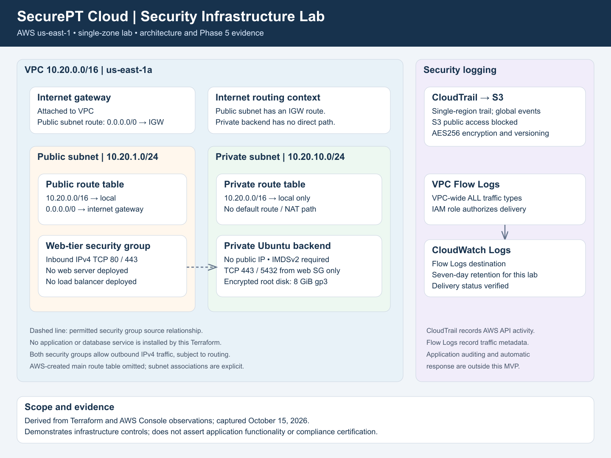

# SecurePT Cloud Security Lab

A healthcare-focused AWS infrastructure security portfolio lab built with Terraform. It models public/private network segmentation, a protected backend demonstration server, encrypted storage, and infrastructure logging for a small physical therapy practice scenario.

## Project status

Phases 1-6 are complete for the recovered portfolio MVP scope. Documentation was synchronized to the original WSL repository on October 15, 2026. On October 16, the documentation was committed in the Windows Git copy with the original deployment history preserved, and the public GitHub repository was created. Phase 7 publication was verified on October 16, 2026. All seven phases of the recovered portfolio MVP are complete. The original WSL checkout remains the deployment working copy. The backend is a demonstration EC2 instance; a clinical application, database service, and patient authentication are not installed by this Terraform.

## Architecture



The VPC uses 10.20.0.0/16, containing public subnet 10.20.1.0/24 and private subnet 10.20.10.0/24 in one availability zone. The public route table has a default route to the internet gateway. The private route table has only the VPC local route. No NAT gateway, public web server, or load balancer is deployed.

The backend has no public IP and requires IMDSv2. Its security group permits inbound TCP 443/5432 only from resources assigned the web-tier security group. Both security groups permit all outbound IPv4 traffic, subject to routing. Its root EBS volume is 8 GiB gp3 and encrypted; the console shows the aws/ebs key alias.

The /16 is a generous parent address pool for subnet expansion; it is not the size of an office LAN or a requirement for the clinic. See [address-plan explanation](docs/addressing_rationale.md) for the math and tradeoffs.

## Completed work and evidence

| Phase | Delivered | Evidence |
|---|---|---|
| 1 | VPC, subnets, routing, gateway, security groups | [Network summary](docs/phase1_deployment_summary.md) |
| 2 | Private Ubuntu EC2, encrypted root disk, IMDSv2 | [Backend summary](docs/phase2_private_backend_summary.md) |
| 3 | CloudTrail to protected S3 audit storage | [Audit summary](docs/phase3_audit_logging_summary.md) |
| 4 | VPC Flow Logs and CloudWatch destination | [Flow Logs summary](docs/phase4_vpc_flow_logs_summary.md) |
| 5 | Architecture artwork and 14 actual console screenshots | [Evidence package](docs/phase5_evidence_summary.md) |
| 6 | Referenced safeguards mapping and README polish | [Documentation summary](docs/phase6_documentation_summary.md) |
| 7 | Publication review, GitHub and job packaging | [Publication verification](docs/phase7_status.md) |

The explicit seven-phase handoff was recovered from the original OpenClaw conversations. See [roadmap provenance](docs/recovered_roadmap.md). Earlier plans included broader future work; an application demo and automated response are extensions to this MVP.

## Verification

On October 14, 2026, the owner shared read-only CLI output showing a no-change Terraform plan, successful CloudTrail and Flow Logs delivery, private EC2 placement, required IMDSv2, encrypted storage, and intended backend security-group rules.

On October 15, the assistant directly inspected the signed-in AWS Console and captured [14 screenshots](screenshots/README.md). The console confirmed private local-only routing, public IGW routing, the sole listed backend security group, instance and disk settings, CloudTrail Logging with a delivery timestamp, active Flow Logs, and one-week CloudWatch retention. A recent delivered Flow Logs record reported NODATA; no end-to-end connectivity or traffic-blocking test was performed. See [verification record](docs/verification_record.md).

## Security purpose and boundaries

Private placement and limited inbound rules reduce exposure. Encrypted EBS demonstrates storage encryption. CloudTrail provides AWS API visibility; VPC Flow Logs provide eligible flow metadata, not packet contents or clinical-record audit events. Terraform configures the S3 log bucket with public-access blocking, AES256 server-side encryption, and versioning; those bucket settings were reviewed in code rather than separately screenshot-verified.

The [HIPAA-aligned safeguards mapping](docs/hipaa_controls_mapping.md) links selected safeguards to evidence and gaps using HHS/eCFR sources. It is an educational control analysis, not a compliance certification or assessment of a real practice. Application identity/TLS, clinical access auditing, operating-system administration and patching, tested backups/restores, incident procedures, workforce/physical safeguards, and vendor arrangements are not established by this lab. CloudTrail is single-region, and log file validation is disabled. Seven-day Flow Logs retention is a lab choice, not a production retention policy.

## Repository guide

- terraform/: deployed infrastructure source and provider lock file.
- [Architecture explanation](docs/architecture.md), [editable SVG](diagrams/securept-architecture.svg), and [Mermaid source](diagrams/architecture.mmd).
- [Screenshot gallery](screenshots/README.md) and [image hashes](screenshots/manifest.json).
- [Security controls and gaps](docs/security_controls.md).
- [Address-plan learning note](docs/addressing_rationale.md).
- [Current milestones](docs/milestones.md).

## Inspecting the infrastructure

Requirements: Terraform >= 1.5, AWS CLI with appropriate existing access, and the correct working directory/state for the deployed environment. The configured region is us-east-1. From the original WSL repository:

```bash
cd ~/portfolio/secure-pt-cloud/terraform
terraform fmt -check
terraform init
terraform validate
terraform plan
```

Review the plan before applying any change. Reuse the existing state: empty state can propose duplicate resources. The latest Ubuntu AMI is selected dynamically, so later plans can propose replacing the instance when the image changes. The current Windows copy is being used for documentation, not deployment.

## Publication and cost

Before publishing, review tracked files and Git history as well as .gitignore. Exclude credentials, state, plans, private variables, and raw personal OpenClaw history. Review account/resource identifiers in console evidence. EC2, storage, and logging can incur charges; Free Tier eligibility is account-specific. Document any eventual cleanup and retain appropriate evidence/state.

## Interview explanation

"I built a healthcare-focused AWS infrastructure lab with Terraform. I separated public and private subnets, deployed a backend without a public IP, required IMDSv2, encrypted its storage, and configured CloudTrail and VPC Flow Logs. I verified deployed settings and mapped the evidence to selected healthcare safeguards. I documented the limits, including no application tier, tested backups, or automated response."
