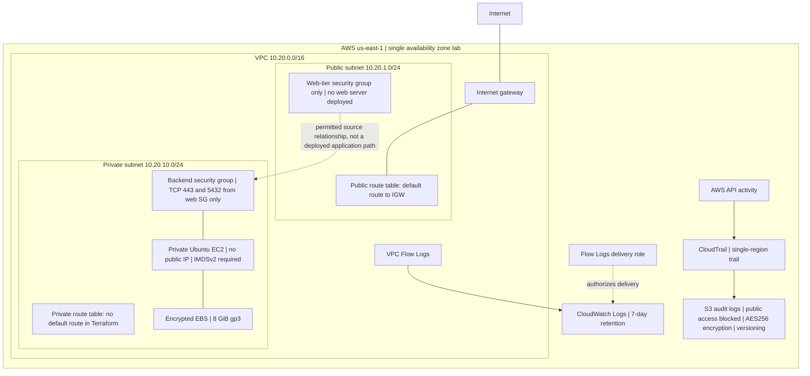

# Architecture

Source: Terraform configuration reviewed October 14, 2026. Live evidence is recorded separately in verification_record.md.

[Editable SVG](../diagrams/securept-architecture.svg) | [AWS screenshot gallery](../screenshots/README.md)

## Network boundary

The VPC uses 10.20.0.0/16. Public subnet 10.20.1.0/24 has a default route to the internet gateway. Private subnet 10.20.10.0/24 has its own route table, with no default route defined in Terraform. Both subnets select the same availability zone; this is a single-zone lab.

## Allowed connections

| Target | Protocol/port | Permitted source |
|---|---|---|
| Web-tier security group | TCP 80 and 443 | Any IPv4 source |
| Backend security group | TCP 443 and 5432 | Resources assigned the web-tier security group |

A security group rule permits traffic; it does not create a server, HTTPS certificate, database, or listener. No public web compute is currently defined. No inbound SSH rule is defined on the backend group. Both groups permit all outbound IPv4 traffic, subject to routing and other controls.

## Compute and storage

The backend is Ubuntu EC2 with t3.micro configured as its default instance type, no public IP, IMDSv2 required, and an encrypted 8 GiB gp3 root volume. No customer-managed KMS key is specified in the EC2 resource. The encryption check confirmed the volume encryption flag, not the key policy or key ownership.

## Logging

CloudTrail delivers API audit logs to S3. Terraform enables bucket versioning, AES256 server-side encryption, and public access blocking. The trail is single-region, with global service events included. VPC Flow Logs capture ALL eligible flow traffic and deliver to CloudWatch through an IAM role. CloudWatch retention is configured as seven days for this lab. Flow metadata is distinct from packet content and application audit records.

Solid diagram lines show configured relationships. The dashed web-to-backend connection is an allowed security group source relationship; no end-to-end application connection has been demonstrated.
