# Phase 5 - AWS screenshot evidence

Captured October 15, 2026 from the signed-in AWS Console in us-east-1. Only read-only navigation was performed; no resources or security settings were changed. Images are actual console captures. The navigation header was cropped at capture time; resource/account identifiers remain in some panels and need publication review in Phase 7.

The narrow browser viewport required multiple screenshots for wide maps and tables. Read the paired inbound-port/source screenshots together. Screenshots are observations of configuration, not proof of end-to-end connectivity.

## VPC and public/private subnets

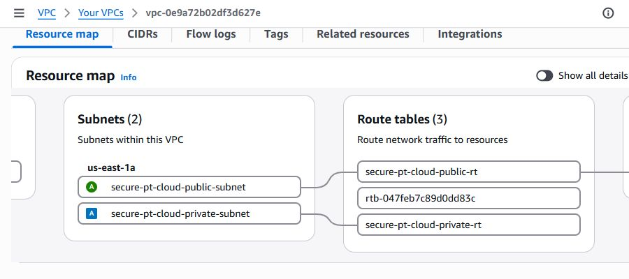

## Explicit subnet-to-route-table associations

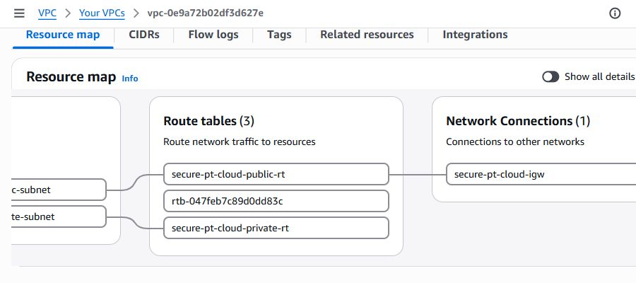

## Public route table connected to internet gateway

## Private route table: local route only

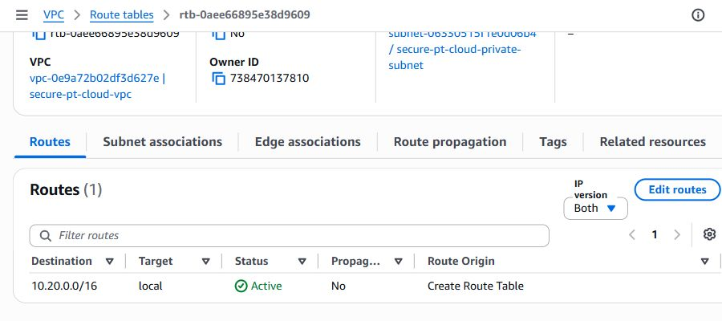

## Public route table: default route to internet gateway

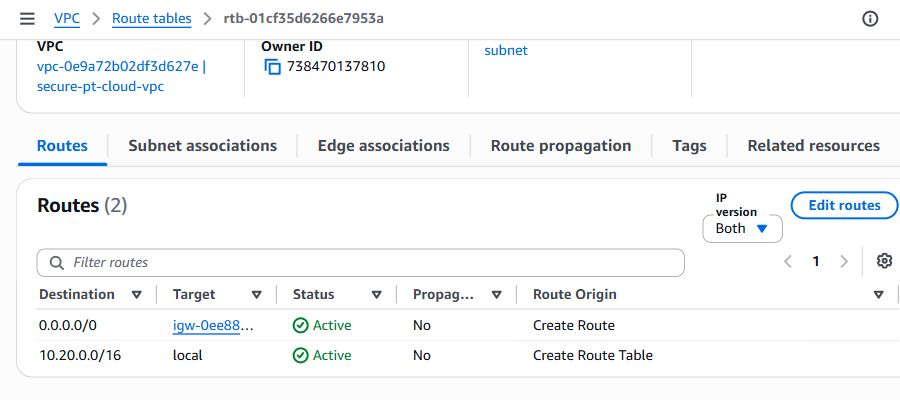

## Backend running with a private IP and no public IP

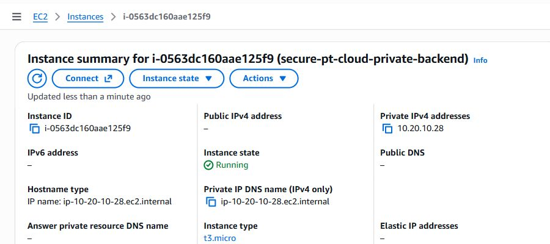

## Backend private-subnet placement and IMDSv2 Required

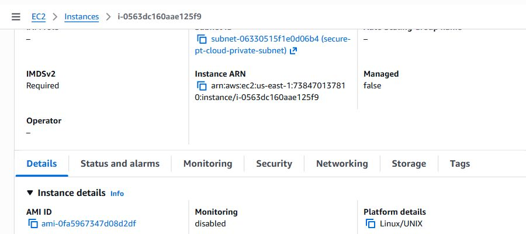

## Backend inbound ports: TCP 5432 and 443

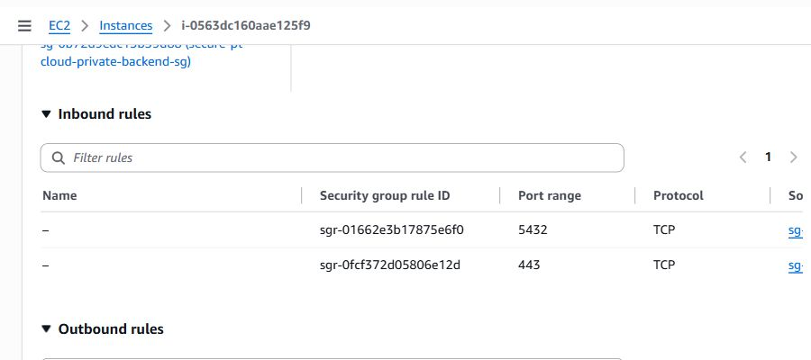

## Both inbound rules reference the web-tier security group

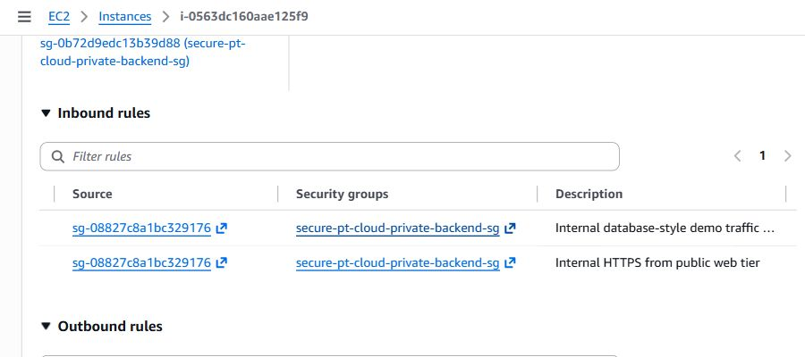

## EBS encryption enabled with aws/ebs key alias

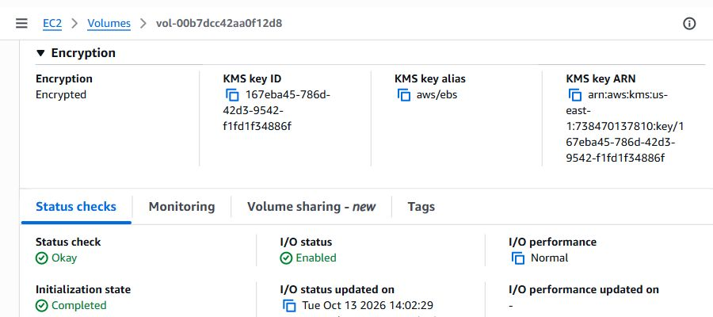

## VPC Flow Log active, ALL traffic type, CloudWatch destination

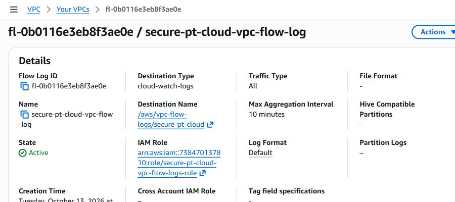

## CloudTrail Logging status and latest delivery time

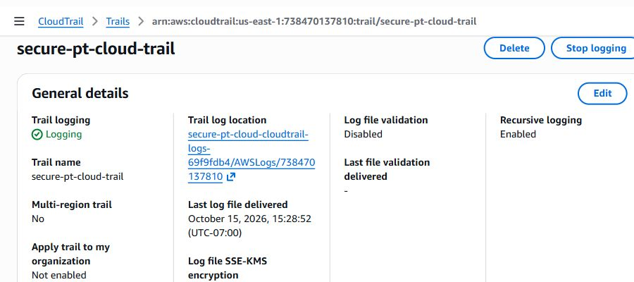

## Flow Logs group retention: one week; stored data present

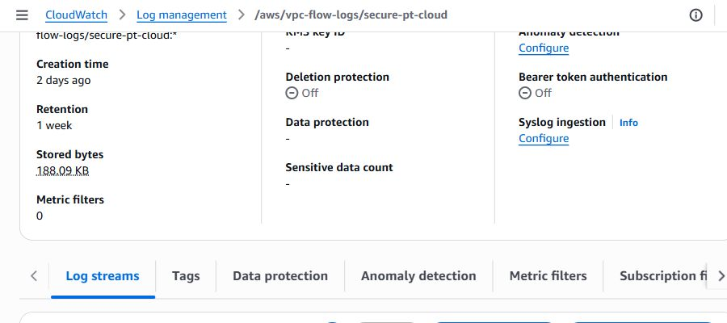

## Delivered Flow Logs record with NODATA status

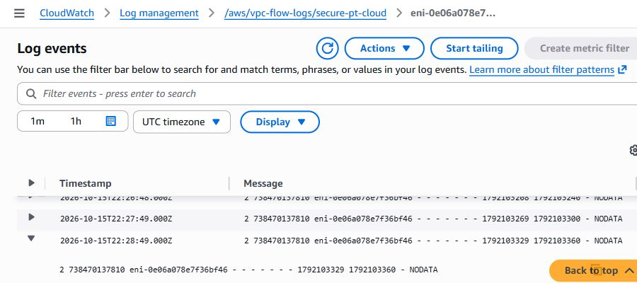

## Interpretation of the delivered log record

The inspected recent record has NODATA status. AWS defines this as no traffic to or from that interface during the aggregation interval. It confirms a record was available in the destination, not that a permitted or rejected application connection was tested. [AWS Flow Logs field reference](https://docs.aws.amazon.com/vpc/latest/userguide/flow-log-records.html).

## Evidence boundaries

The CloudTrail panel shows single-region logging, a delivery timestamp, log file validation disabled, and SSE-KMS not enabled for trail log files. The Terraform S3 bucket uses AES256 server-side encryption (SSE-S3); absence of trail SSE-KMS is not the same as absence of bucket encryption. S3 public-access/versioning settings were inspected in Terraform, not separately screenshot-verified here.
